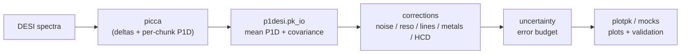

# p1desi

**p1desi** is a suite of tools to analyse the **one-dimensional Lyman-alpha
forest power spectrum (P1D)** measured by [picca](https://github.com/igmhub/picca)
on DESI data. It was developed for the first DESI P1D measurements (Early Data
Release and beyond).

Given picca's per-chunk P1D outputs, p1desi lets you:

- **read and represent** a mean P1D together with its raw / noise / difference
  power, resolution correction and covariance ([`pk_io`](api/pk_io.md));
- **correct** the measurement for instrumental and astrophysical effects —
  pipeline noise, spectrograph resolution, sky-line and continuum masking, metal
  and high-column-density absorption ([`corrections`](api/corrections.md),
  [`noise`](api/noise.md), [`resolution`](api/resolution.md),
  [`skylines`](api/skylines.md), [`metals`](api/metals.md),
  [`hcd`](api/hcd.md));
- **build the error budget** — statistical and systematic covariances, smoothing
  and regularisation ([`uncertainty`](api/uncertainty.md));
- **validate** the measurement against mocks and reference measurements
  ([`mocks`](api/mocks.md), [`spectra_statistics`](api/spectra_statistics.md));
- **plot** the P1D, its redshift evolution and comparisons
  ([`plotpk`](api/plotpk.md));
- keep a consistent **bookkeeping** of analysis variants and catalogs
  ([`bookkeeping`](api/bookkeeping.md), [`catalogs`](api/catalogs.md)).

## Where p1desi sits

p1desi is a **Pillar 2** (estimators + likelihoods) analysis package: it starts
from picca P1D products and produces a corrected P1D measurement with its
covariance, ready for cosmological interpretation.

## Next steps

- [Getting started](getting-started.md) — install and load your first P1D.
- [Analysis pipeline](pipeline.md) — the correction chain end to end.
- [API reference](api/index.md) — every module, class and function.

!!! note "Units"
    Wavenumbers are handled in either **Angstrom⁻¹** or **velocity units
    (s/km)**; the [`Pk.velunits`](api/pk_io.md) flag records which, and
    [`utils`](api/utils.md) provides the conversions.
