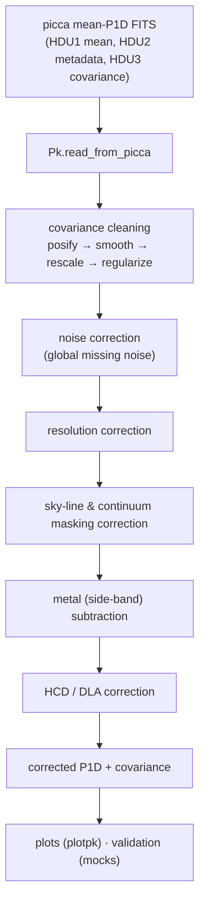

# Analysis pipeline

p1desi turns picca's per-chunk P1D outputs into a **corrected mean P1D with a
clean covariance**. The stages below can be run individually or chained through
[`pk_io.load_and_apply_correction`](api/pk_io.md).

## Stages

| Stage | Module | What it does |
|---|---|---|
| **Read** | [`pk_io`](api/pk_io.md) | Load the mean P1D, per-bin metadata and covariance into a [`Pk`](api/pk_io.md) object (dicts keyed by redshift bin). |
| **Covariance cleaning** | [`pk_io`](api/pk_io.md), [`uncertainty`](api/uncertainty.md) | Force a positive diagonal, Savitzky–Golay-smooth the diagonal and (2-D) the off-diagonal, apply a multiplicative correction, regularise the eigenvalues, then adopt the covariance as the error. |
| **Noise** | [`noise`](api/noise.md), [`corrections`](api/corrections.md) | Estimate and subtract residual pipeline noise (including a global missing-noise term and high-k asymptote diagnostics). |
| **Resolution** | [`resolution`](api/resolution.md) | Model the spectrograph resolution × pixelisation window and divide it out; report the k where the correction reaches 10 % / 5 %. |
| **Sky lines** | [`skylines`](api/skylines.md) | Identify residual sky emission lines and build the masking correction. |
| **Metals** | [`metals`](api/metals.md) | Fit the metal (e.g. Si III / Si II) contamination from side-band regions and subtract it. |
| **HCD / DLA** | [`hcd`](api/hcd.md), [`corrections`](api/corrections.md) | Apply the Rogers et al. high-column-density contamination correction. |
| **Uncertainty** | [`uncertainty`](api/uncertainty.md) | Assemble the statistical + systematic error budget and its covariance; produce diagnostic plots. |
| **Validation** | [`mocks`](api/mocks.md), [`spectra_statistics`](api/spectra_statistics.md) | Compare against mocks / reference measurements via χ² and KS tests; inspect input-spectrum statistics. |
| **Plotting** | [`plotpk`](api/plotpk.md) | Render the P1D, ratios, residuals, redshift evolution and comparisons. |

## Units convention

Wavenumbers are stored either in **Angstrom⁻¹** or in **velocity units (s/km)**;
the [`Pk.velunits`](api/pk_io.md) flag records which. Conversions use the
Lyman-alpha rest wavelength and are provided by [`utils`](api/utils.md)
(`kAAtokskm`, `kskmtokAA`). The dimensionless power `Δ² = k·P/π` is stored as
`norm_p`.

## Bookkeeping

Every analysis variant is identified by its region, sky-line list, quasar
catalog, DLA catalog, BAL cut and noise estimate. [`bookkeeping`](api/bookkeeping.md)
turns those into consistent folder and file names, so the same code can iterate
over all variants (see `return_pk_path_interface`).
